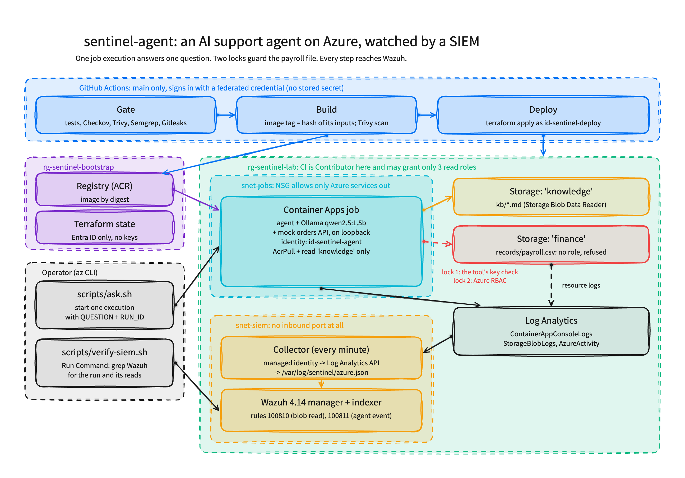

# sentinel-agent

[](https://github.com/Keniolax/sentinel-agent/actions/workflows/pipeline.yml)

An AI support agent that runs on Azure, can read only what it needs, and reports every step
it takes to a Wazuh SIEM. This is the build stage of the bootcamp capstone (week 18).



## What it does

The agent answers one customer question for a made-up outdoor shop. It runs a small local
model (qwen2.5:1.5b on Ollama 0.40.13, pinned by digest) and has three tools: list the help
articles, read one help article, and look up an order in a mock internal API. Each question
starts one execution of an Azure Container Apps job. The job answers and stops.

| Part | How it is protected |
|---|---|
| Help articles (`knowledge` container) | The job's managed identity has Storage Blob Data Reader on this container only. |
| Payroll file (`finance` container) | Two locks: the tool's key check refuses any key outside `kb/`, and the identity has no role on the container. |
| Job network | The subnet's NSG allows only the Azure services the platform needs and denies the rest of the internet. |
| Logs | The agent writes one JSON line per step: question, model reply, tool call (allowed, denied or error), answer. These lines hold SHA-256 hashes of the question and answer, not the text. The agent then prints the answer once as its output, so the answer text does reach the console log. |
| SIEM VM | No inbound port. Operators use Run Command. A collector reads Log Analytics with the VM's managed identity and writes JSON lines that Wazuh reads; no client secret exists. |
| Deploys | GitHub Actions signs in with a federated credential on `main`. The deploy identity is Contributor on the lab group only, and may grant only AcrPull, Storage Blob Data Reader and Log Analytics Reader, only to managed identities. |
| Threat detection | Microsoft Defender for Storage and Defender for Servers P1. Their alerts go to the activity log, which the workspace collects. |

The pipeline (`.github/workflows/pipeline.yml`) has three jobs. **Gate** runs the unit tests,
`terraform validate`, Checkov, Trivy (configuration and dependencies), Semgrep and Gitleaks
over the whole history; any finding fails it. **Build** tags the image with a hash of its
inputs, builds it only if that tag is new, and scans it with Trivy. **Deploy** runs
`terraform apply`.

## Run it

You need an Azure subscription where you are Owner, the Azure CLI, Terraform 1.14, and the
GitHub CLI signed in to a fork of this repository.

```
az login
infra/bootstrap/prereqs.sh                # register resource providers (free)
cd infra/bootstrap
terraform init && terraform apply -var subscription_id=$(az account show --query id -o tsv)
cd ../.. && scripts/set-repo-vars.sh      # IDs and names only, no secrets
git push                                  # the pipeline deploys infra/main
```

Then, from your machine:

```
scripts/ask.sh "Please read the help article kb/returns.md and tell me how many days I have to return an item."
scripts/verify-siem.sh <run_id from ask.sh>
scripts/probe-finance.sh
```

`ask.sh` prints the run ID, the execution status and the agent's log lines. `verify-siem.sh`
asks the SIEM VM, through Run Command, for four counts and exits 0 only when all are above
zero: the run's log lines, the agent identity's blob reads, alerts from rule 100810 (blob
read), and alerts from rule 100811 for this run. `probe-finance.sh` skips the agent and asks
storage for the payroll file with the job's identity; it exits 0 only if Azure refuses with
`AuthorizationPermissionMismatch`.

The SIEM VM (Standard_D2as_v6) costs about $2 a day. Stop it when you are done:
`az vm deallocate -g rg-sentinel-lab -n vm-sentinel-siem`. To remove everything, run
`terraform destroy` in `infra/main` and then in `infra/bootstrap`.

The AWS version of this project, which an AWS account block stopped before it could run, is
at tag [`aws-v1`](https://github.com/Keniolax/sentinel-agent/tree/aws-v1).

## What I learned

- **The live run found a bug the unit tests could not.** The tests replace the model with a
  script, so none of them sent a real request. The first execution on Azure failed with
  `unknown url type: 127.0.0.1`: the image sets `OLLAMA_HOST=127.0.0.1:11434` for
  `ollama serve`, and the client read the same variable as a URL. A test now checks the URL
  that is sent, and it fails on the old code.
- **A tool-using agent can skip its tools.** Asked "What is your return policy?", the 1.5B
  model answered from its own training and called no tool, although the system prompt says
  to use them. The answer was plausible and unsupported. Asked to read `kb/returns.md`, it
  called `kb_get` and answered from the article (30 days). The logs show the difference:
  `tool_calls: 0` against `tool_calls: 1`.
- **The second lock works without the first.** `probe-finance.sh` skips the agent's key
  check and asks for the payroll blob with the job's identity. Azure refused it with
  `403 AuthorizationPermissionMismatch`. With a Storage Blob Data Reader grant added on the
  `finance` container for a few minutes, the same probe read the file and failed, so the
  probe tests the role assignment and nothing else.
- **A refused read is evidence, but the week-18 rule does not rank it.** The 403 reached
  Wazuh with the identity's object ID, the caller's address and the path, under rule 100810
  at level 3, the same level as an allowed read.
- **Wazuh's Azure module needs a client secret; a managed identity does not.** The module
  reads Log Analytics through an app registration with a secret on disk. The collector here
  asks the VM's metadata service for a token instead, so the VM holds no secret. It selects
  rows by ingestion time, so a row that arrives late is still collected.
- **Azure capacity is a deploy-time failure, not a plan-time one.** East US 2 refused five
  VM sizes for this trial subscription with `SkuNotAvailable` although quota allowed them.
  `terraform plan` cannot see this. Creating one throwaway VM per size through the REST API
  found a size that worked (D2as_v6) in one pass.
- **Logs arrive in minutes, not seconds.** Blob reads reached Log Analytics about two minutes
  after the event and console lines three to seven minutes after. The SIEM had the whole run
  within ten minutes. A detection that must act faster needs another path.
- **Defaults can cost money.** Turning on Defender for Storage also turned on per-GB malware
  scanning and sensitive-data discovery, though the Terraform resource listed neither. The
  stack now turns both off when it creates the plan.
